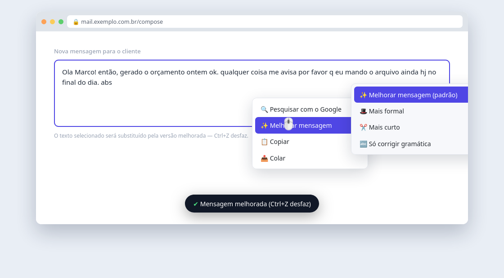
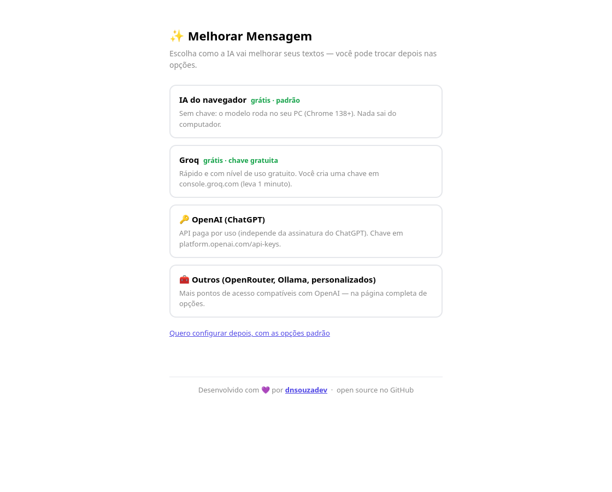
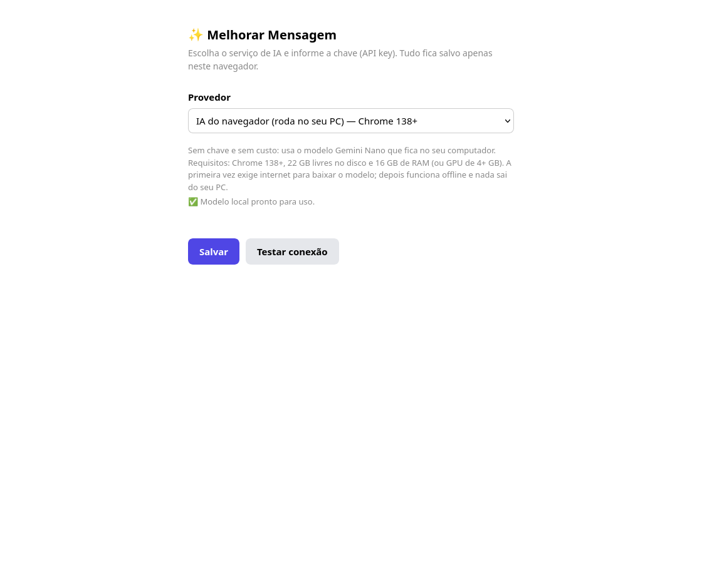

<div align="center">


# ✨ Melhorar Mensagem

**Melhore suas mensagens com IA direto onde você escreve.**
Selecione o texto → clique com o direito → escolha o estilo → o texto é substituído no campo.

🆓 IA local no navegador (Chrome 138+, sem chave) · 🔑 ou sua API favorita (OpenAI, Groq, OpenRouter, Ollama…)

[](README.md) [](README.en.md) [] [] [] [](LICENSE)

</div>

---

## 🖼️ Em ação



*Frase torta escrita às pressas? Menu de contexto, um clique, texto substituído.*

---

## 🤔 Por que esta extensão existe

Todo dia, antes de mandar uma mensagem pra um cliente, a rotina era: escrever a frase torta, abrir o ChatGPT, colar, pedir pra corrigir, copiar de volta, colar no campo. Agora é: **selecionar, clicar com o direito, escolher o estilo. Segundo e meio e está pronto.**

## ✨ O que ele faz

- **Menu de contexto em campos editáveis** (Gmail, WhatsApp Web, formulários, `<textarea>`, `<input>` e contenteditable, inclusive dentro de iframes).
- **4 estilos de escrita** direto no submenu do botão direito:
  - ✨ **Melhorar mensagem (padrão)** — corrige e deixa profissional
  - 🎩 **Mais formal** — tom adequado para clientes e superiores
  - ✂️ **Mais curto** — remove enrolação, mantém o essencial e a cortesia
  - 🔤 **Só corrigir gramática** — conservador, altera o mínimo possível
- **Substituição preservando o Ctrl+Z** (usa `execCommand('insertText')`; o histórico de desfazer continua funcionando).
- **Feedback sem obstrução**: toast discreto ("Melhorando…", sucesso, erro com manual na mão).
- **Zero cadastro para começar**: no Chrome 138+ usa o modelo **Gemini Nano que baixa no seu computador** — sem chave, sem nuvem, offline depois do primeiro download.
- **Privacidade**: a chave de API fica salva apenas no navegador; nenhum servidor entre você e o provedor.

<div align="center">

| Configuração inicial (1ª vez) | Opções completas |
| --- | --- |
|  |  |

</div>

---

## 📦 Instalação

### Chrome / Edge / Brave

```bash
git clone https://github.com/dnsouzadev/melhorar-mensagem.git
cd melhorar-mensagem
python3 build.py          # gera dist/chrome e dist/firefox
```

1. Abra `chrome://extensions`
2. Ative o **Modo do desenvolvedor** (canto superior direito)
3. **Carregar sem compactação** → escolha a pasta `dist/chrome`
4. O assistente de primeira configuração abre sozinho 🎉

### Firefox

1. Abra `about:debugging#/runtime/this-firefox`
2. **Load Temporary Add-on…** → `dist/firefox/manifest.json`

Instalação temporária expira ao fechar o navegador. Para uso diário, envie `dist/firefox.zip` na [assinatura própria do AMO](https://addons.mozilla.org/developers/addon/submit/) (gratuita) e instale o `.xpi` assinado.

> ℹ️ No Firefox a IA nativa não existe; o assistente já sugere o **Groq** (grátis) por lá.

---

## ⚙️ Configuração

Assistente inicial pergunta **como você quer usar a IA**:

| Provedor | Custo | Chave |
| --- | --- | --- |
| **IA do navegador** (padrão) | 🆓 grátis, no seu PC | — |
| **Groq** | 🆓 nível de uso gratuito | console.groq.com/keys |
| **OpenAI** | pago por uso (independente da assinatura do ChatGPT) | platform.openai.com/api-keys |
| **OpenRouter** | modelos de bandeira, alguns gratuitos | openrouter.ai/keys |
| **Ollama local** | 🆓 100% offline | — |
| **Personalizado** | qualquer endereço compatível com OpenAI | seu serviço |

### IA do navegador (recomendada no Chrome)

Usa a [Prompt API](https://developer.chrome.com/docs/ai/prompt-api) com **Gemini Nano local**. Requisitos do PC:

- Chrome **138+** (em Windows 10/11, macOS 13+, Linux)
- **22 GB** livres no disco (volume do perfil do Chrome)
- **16 GB de RAM** (com 4+ núcleos) **ou GPU com 4+ GB de VRAM**
- Internet ilimitada **apenas no primeiro download**

Se aparecer o botão **“Baixar modelo”** na página de opções/assistente, clique e acompanhe a porcentagem. Depois disso funciona offline. Estado interno: `chrome://on-device-internals`.

### Ollama (opcional)

O Ollama bloqueia origens desconhecidas por padrão. Inicie o serviço liberando as origens das extensões:

```bash
OLLAMA_ORIGINS="chrome-extension://* moz-extension://*" ollama serve
```

---

## 🕹️ Como usar

1. Escreva sua mensagem (torta mesmo 😉)
2. **Selecione os trechos** que quer revisar
3. Clique com o direito → **✨ Melhorar mensagem** → escolha o estilo
4. Confira o resultado e envio. *Não gostou?* **Ctrl+Z desfaz.**

Toast de confirmação aparece na parte inferior da tela. Erros trazem a causa (“Chave da API inválida”, “Limite de uso atingido”…) e uma dica do que fazer.

---

## 🩺 Solução de problemas

| Sintoma | Diagnóstico provável |
| --- | --- |
| “Chave de API inválida ou ausente” | Chave errada/expirada ou provedor trocado nas Opções |
| “Não foi possível conectar à API” | Internet, endereço errado ou Ollama sem `OLLAMA_ORIGINS` |
| “A IA demorou demais” | Modelo sobrecarregado — tente de novo |
| Menu não aparece | O clique não foi dentro de um campo editável, ou a página é interna (`chrome://…`) |
| Menu não aparece após editar código | Recarregue a extensão (Chrome: botão 🔄 em `chrome://extensions`; Firefox: Reload em `about:debugging`) |
| IA nativa “indisponível” | Chrome < 138 ou PC fora dos requisitos |

---

## 🛠️ Desenvolvimento

```
manifest.json      manifesto base (Chrome); Firefox é gerado por build.py
background.js      submenu de contexto, abertura do assistente, IA nativa (fallback)
content.js         captura a seleção, chama a IA, substitui o texto
options.html/js    configuração completa (provedor, chave, modelo, teste de conexão)
onboarding.html/js assistente de primeira configuração
build.py           gera dist/chrome e dist/firefox (+ .zip prontos para lojas)
docs/img           prints usados nos READMEs
```

- **Modo demonstração**: abrir `options.html` ou `onboarding.html` direto no navegador (sem instalar a extensão) ativa uma emulação do `chrome.storage` e da `LanguageModel` — útil para ajustar layout e capturar prints.
- **Chaves de versão** (SemVer + tags git):

```bash
# 1. atualize "version" no manifest.json
# 2. registre a mudança no CHANGELOG.md
git commit -am "v0.5.1: descrição"
git tag -a v0.5.1 -m "resumo"
git push origin master --tags
python3 build.py
```

### Caminhos da engenharia

- Tudo é um **código único** para os dois navegadores; `build.py` só troca `background` (service worker → scripts) e adiciona o ID do Gecko no Firefox.
- A substituição usa `document.execCommand("insertText")` **porque preserva o desfazer**; há fallback manual (sem undo) para o caso de algum navegador remover essa API legada.
- A IA nativa tem **fallback duplo**: tenta primeiro no próprio frame do content script; se não houver acesso, delega ao service worker (que mantém a sessão em cache).

---

## 🗺️ Roteiro

- [ ] Popup com prévia antes da substituição (aceitar/descartar)
- [ ] Atalho de teclado (ex.: Alt + M)
- [x] Estilos no menu — v0.4.0
- [x] IA nativa do navegador — v0.2.0
- [x] Configuração inicial — v0.3.0
- [ ] Publicação nas lojas (Chrome Web Store, AMO)

Ideias novas? Issues e PRs são bem-vindos!

---

## 🧠 Privacidade

- O texto selecionado é enviado **apenas ao provedor que você escolheu** (local para IA do navegador ou Ollama).
- Chaves ficam em `chrome.storage` no seu navegador; **nada** trafega pela extensão para terceiros.
- A extensão não coleta histórico, não injeta tracking e não faz telemetria.

---

## 📄 Licença

[MIT](LICENSE) — © 2026 <a href="https://github.com/dnsouzadev">dnsouzadev</a>
